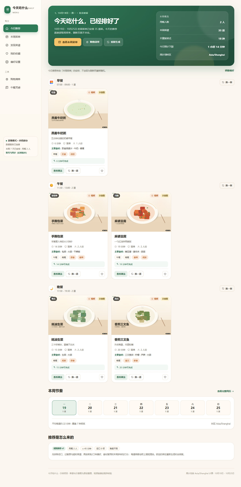
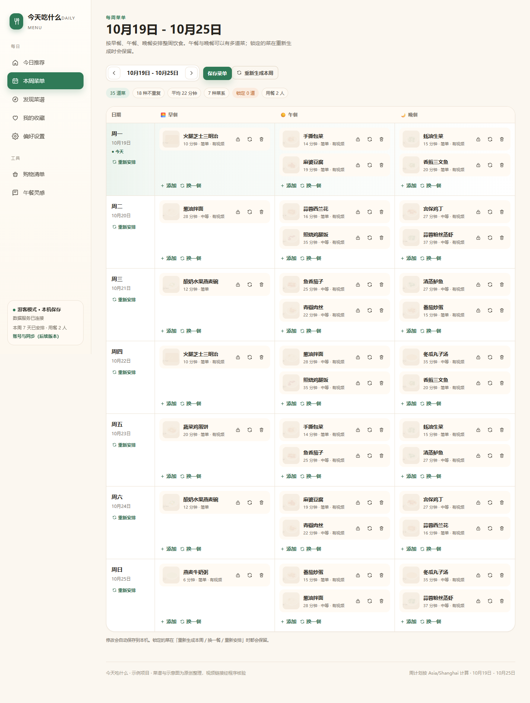

# 今天吃什么 · Daily Menu

面向家庭日常做饭场景的菜谱推荐应用：每天打开就知道吃什么，也能提前排好一周菜单、按菜单生成购物清单，并查看带图文步骤和核验视频的菜谱。

项目包含 **PC 网页 / 手机 H5 / 微信小程序** 三个端，共用同一份数据模型、推荐规则与内容数据。

> **在线演示**：<https://hu942671090.github.io/daily-menu/> · **源码**：<https://github.com/hu942671090/daily-menu>
>
> 本项目是完整可运行的**演示工程**：Web 演示已发布到 GitHub Pages；微信小程序尚未提交审核。
> 配图为脚本生成的示意图（非实拍），AppID 为游客占位值，详见 [已知限制](#已知限制与后续计划)。

---

## 一、三端与截图

| PC 网页（1440px） | 手机 H5（390px） |
| --- | --- |
|  |  |
|  |  |

- **PC 网页**：左侧导航 + 宽屏卡片 + 7 天周历，适合规划整周饮食。
- **手机 H5**：底部导航、日期切换、单列卡片，突出步骤编号与图片。
- **微信小程序**：原生页面（非 web-view 套壳），复用同一套推荐与持久化逻辑。

三端截图与端到端验证产物在 `artifacts/`（运行 `npm run verify:e2e` 可重新生成）。

---

## 二、已实现功能

### 每日推荐
- 首页展示当天日期、今日三餐与本周概览；**今日推荐直接读取本周菜单中对应日期的安排**，同一天刷新不会重新随机。
- 菜谱卡片包含图片、名称、预计总耗时、难度、适用人数、主要食材、口味标签，以及「查看做法 / 收藏 / 换一道」。
- 默认按北京时间组织日期与周计划；时区可在偏好设置中切换，日期工具支持无 `Intl` 时的兜底。

### 每周菜单
- 周一至周日 × 早餐/午餐/晚餐；早餐 1 道，午晚餐各 2 道，可继续添加或移除。
- 按偏好生成整周菜单；支持「上一周 / 下一周 / 回到本周」，下一周菜单可单独生成并保存。
- 单道替换（弹窗选择）、重新生成某一餐、重新安排某一天、重新生成整周。
- **锁定菜品**：锁定后重新生成仍会保留；支持解锁。
- 修改自动保存到本机，再次进入自动恢复；「保存菜单」按钮提供明确反馈。
- 推荐结果附推荐理由，锁定与未锁定状态在周历中可直接看到。

### 图文菜谱详情
- 成品图、简介、菜系/口味、准备/烹饪时间、难度、基准份量。
- 食材与调料分组，带数量与单位；调整人数后按比例换算，「少许 / 适量」保留文字。
- 按顺序排列的步骤，每步有独立示意图、编号、正文、火候与时间节点。
- 火候/处理提示、可替换食材、常见失败原因、内容来源与许可、完善度标记。
- 每个步骤图都是独立生成的示意图，**没有把封面图复用作步骤图**。

### 视频教程
- 关联 bilibili 做饭视频，记录平台、标题、作者、原始链接、对应菜谱、核验状态与核验时间。
- 链接和元数据由脚本通过 bilibili 公开接口核验后写入，**不存在编造 BV 号、标题或作者**。
- 没有匹配结果时明确显示「暂无已核验视频」；另有单独区分的「搜索相关视频」入口（明确标注为搜索页，不是已匹配教程）。
- 抖音：无公开免授权检索接口，首版不写入任何抖音视频记录，只提供标注清楚的搜索入口。

### 偏好与辅助
- 用餐人数、偏好菜系/口味、忌口、过敏原、不喜欢食材、可接受耗时、可接受难度、时区。
- 菜谱搜索（菜名 + 主要食材），按餐次/耗时/难度/菜系/口味筛选，收藏列表。
- 购物清单：按整周或指定日期汇总，同名同单位合并数量，勾选已购并持久化。
- 游客模式，无需登录；账号与跨端同步接口已在共享层预留。

---

## 三、技术方案

| 层次 | 选型 | 理由 |
| --- | --- | --- |
| PC/H5 | React 18 + TypeScript + Vite 5 + React Router | 组件化、生态成熟；Vite 构建快，同一套代码通过 CSS 断点适配 PC 与 H5 |
| 小程序 | 微信原生（WXML/WXSS/JS） | 直接用官方能力，避免 web-view 业务域名与个人主体限制；页面结构符合微信交互习惯 |
| 共享逻辑 | `packages/shared`（TypeScript） | 数据模型、日期/时区、份量换算、推荐引擎、菜单操作、购物清单、持久化全部只有一份实现 |
| 内容数据 | JSON + 编译脚本 + 校验器 | 内容是数据不是代码；可校验、可导入、可替换来源 |
| 数据服务 | Node 20+ + Express + esbuild | 提供内容、推荐、购物清单等无状态接口，生产环境同源托管 Web 构建产物 |
| 持久化 | localStorage（Web/H5）+ `wx.*StorageSync`（小程序） | 游客模式开箱即用；通过 Repository 接口隔离，未来可换 API/账号 |
| 测试 | Node Test Runner + tsx；Playwright-core + Edge | 共享逻辑单测、小程序页面逻辑冒烟测试、真实浏览器 E2E |

**为什么没有用 pnpm workspace**：当前工作区位于 SMB 共享目录，文件系统不允许创建符号链接，pnpm/npm workspace 会失败。因此使用单包结构 + TypeScript/Vite 路径别名实现共享；这不会影响三端复用，克隆到本地 NTFS 后仍可按需改造成 workspace。

详细架构、数据模型与接口见 [docs/architecture.md](docs/architecture.md)。

---

## 四、目录结构

```
daily-menu/
├─ apps/
│  ├─ web/                     PC + H5 前端（React + Vite）
│  │  ├─ src/pages/            首页、周菜单、发现、详情、收藏、偏好、购物清单
│  │  ├─ src/components/       卡片、步骤、视频、弹层、状态组件
│  │  └─ src/lib/              应用状态、数据源、本地仓储
│  ├─ server/                  数据服务（Express）
│  └─ miniprogram/             微信小程序工程（原生）
│     ├─ pages/                7 个页面
│     ├─ shared/               shared + content 的构建产物 bundle.js
│     ├─ utils/app-data.js     小程序数据访问层
│     └─ scripts/              打包与自动检查脚本
├─ packages/
│  ├─ shared/                  数据模型、日期、推荐、菜单、购物清单、存储、同步接口
│  │  └─ test/                 30 个单元测试
│  └─ content/
│     ├─ data/recipes/         25 道示例菜谱（JSON）
│     ├─ data/videos.json      24 条已核验视频
│     ├─ images/recipes/       158 张原创示意图
│     └─ scripts/              编译、校验、生成图片、视频核验
├─ docs/                       架构、内容规范、平台限制、验证报告、待办
├─ scripts/                    开发启动、服务端构建、E2E 检查
├─ .env.example                环境变量示例（无真实密钥）
└─ README.md
```

---

## 五、快速开始

### 环境要求
- Node.js **≥ 20.19**（推荐 22/24）
- npm ≥ 9
- Python 3.9+ 且安装 Pillow（仅重新生成示意图时需要）

> 本机默认的 `node` 是 16，低于要求。可改用 DeepSeek 运行时自带的 Node 24：
> `C:\Users\Administrator\.dsh\dsh-runtimes\dsh-primary-runtime\dependencies\node\bin\node.exe`
> 下文命令用 `node` 表示，按需替换为该路径。

### 1. 安装依赖
```bash
cd daily-menu
npm install
```
> 在 SMB 共享目录上首次安装约 3 分钟（文件复制较慢），属正常现象。

### 2. 生成内容数据与示意图
```bash
npm run data:build       # JSON → packages/content/src/generated/dataset.ts
npm run data:images      # 生成 158 张示意图（需 Python + Pillow）
npm run data:validate    # 结构 / 枚举 / 图片路径 / 步骤 / 视频引用校验
```
仓库中已包含生成结果；仅修改内容后需要重新执行。

### 3. 启动开发环境
```bash
npm run dev
```
- H5/PC：<http://127.0.0.1:5173>
- API：<http://127.0.0.1:4000/api/health>
- 同一局域网手机调试：将 `apps/web/vite.config.ts` 中 `server.host` 改为 `0.0.0.0` 后重启，用手机访问电脑 IP。
- 工作区在 SMB 共享目录时，Vite 文件监听已切换为轮询模式（`usePolling`）；本地磁盘开发可设 `VITE_DISABLE_POLLING=true` 关闭，降低 CPU 占用。

### 4. 生产构建与启动
```bash
npm run build            # 数据 + Web + 服务端 + 小程序共享包
npm start                # http://127.0.0.1:4000（同时托管 Web 静态站点）
```

### 5. 微信小程序
```bash
npm run build:miniprogram     # 生成 apps/miniprogram/shared/bundle.js
```

1. 用微信开发者工具「导入项目」，目录选择 `apps/miniprogram`；
2. AppID 使用 `project.config.json` 中的 `touristappid`（游客模式），或替换成自己的 AppID；
3. 开发阶段在「详情 → 本地设置」勾选 **不校验合法域名**，否则示意图无法从本机数据服务加载；
4. 编译后从「今日」页开始体验推荐、周菜单、详情、收藏与偏好。

小程序图片地址在 `apps/miniprogram/config/index.js` 的 `assetBaseUrl`，默认 `http://127.0.0.1:4000`；正式环境请改为已备案的 HTTPS 域名并配置 downloadFile 合法域名。

---

## 发布给朋友看（静态托管）

不想部署服务器也可以：前端已经内置全部示例数据，执行一次静态构建即可：

```bash
npm run build:static
# 产物：apps/web/dist-static（约 10 MB，含图片，hash 路由，无需后端）
```

- **最省事**：把 `apps/web/dist-static` 整个文件夹拖到 <https://app.netlify.com/drop>，得到一个可分享的 HTTPS 链接。
- **Cloudflare Pages / GitHub Pages / Vercel**：均可直接上传该目录；GitHub Pages 把内容推到 `gh-pages` 分支即可。
- 访客数据只保存在各自浏览器，互不影响；页面视频跳转 bilibili 官方页。
- 微信小程序不能只发链接，需要正式 AppID、审核或「体验成员」；没有 AppID 时建议先分享 H5。

逐步操作、GitHub 命令与各平台对比见 **[docs/deploy-static.md](docs/deploy-static.md)**。

---

## 六、数据与接口

### 数据模型（`packages/shared/src/types.ts`）
`Recipe` / `IngredientItem` / `RecipeStep` / `RecipeVideo` / `Preferences` / `WeekMenu` / `FavoriteRecord` / `ShoppingListItem`。

内容数据源：
- `packages/content/data/recipes/*.json`（25 道，覆盖早/午/晚餐，8 个菜系）
- `packages/content/data/videos.json`（24 条已核验 bilibili 视频）
- `packages/content/images/recipes/*.png`（158 张示意图）

### 主要接口
| 方法 | 路径 | 说明 |
| --- | --- | --- |
| GET | `/api/health` | 健康检查、内容统计 |
| GET | `/api/meta` | 菜系/口味/难度/餐次、策略、内容统计 |
| GET | `/api/content` | 全量菜谱与视频（Web 优先从接口取，失败回落内置数据） |
| GET | `/api/recipes` | 搜索与筛选：`q`、`meals`、`maxMinutes`、`difficulties`、`cuisines`、`tastes`、`hasVideo` |
| GET | `/api/recipes/:id` | 菜谱详情 + 视频 + 相关菜谱 + 搜索入口 |
| GET | `/api/recipes/:id/videos` | 已核验/未核验视频与空状态文案 |
| GET | `/api/videos` | 视频列表（可按平台/状态/菜谱过滤） |
| POST | `/api/menu/recommend` | 按偏好生成整周菜单（无状态） |
| POST | `/api/menu/regenerate-slot` | 重新生成某一餐（保留锁定） |
| POST | `/api/shopping-list` | 汇总购物清单 |
| GET | `/api/week` | 周起止与日期列表 |
| GET | `/images/...` | 示意图静态资源 |

完整的请求/响应示例见 [docs/architecture.md](docs/architecture.md)。

---

## 七、推荐规则（rules-v1）

1. **硬约束优先**：过敏原、忌口、不喜欢食材、餐次、可接受耗时、可接受难度。过敏原命中后不会因“放宽”恢复。
2. **打分排序**：菜系匹配 +22，口味匹配 +9/项，时间宽裕度 0–10，偏好难度 +5，食材复用最多 +9，本周已出现 −45/次，同菜系重复 −7/次，同餐食材重叠 −6/项，附少量确定性抖动。
3. **多样性**：优先选本周未出现过的菜；食材复用加分用于减少采购种类。
4. **可复现**：相同偏好 + 相同周 + 相同种子 → 相同菜单；只有用户主动「换一道 / 重新生成」才引入新种子。
5. **可解释**：每道菜返回推荐理由，写入菜单快照并在界面展示。
6. **可替换**：`RecommendationStrategy` 接口 + 策略注册表；后续接入智能推荐只需实现新策略，页面与存储无需修改。

当候选不足时，会依次放宽难度、耗时（×1.5），并在返回值与界面中说明，不会编造菜谱。

---

## 八、视频核验与平台限制

```bash
npm run videos:verify     # 搜索候选 → view 接口校验 → 视频页可访问 → 写入 videos.json 并生成报告
```

- 所有视频字段来自 bilibili 官方公开接口；脚本会重新校验标题含菜名、作者、时长、BV 号，并请求视频页确认可访问。
- 相关性判定为「标题关键词匹配」，**不代表逐帧核对做法**，该说明会显示在界面上。
- 没有匹配的菜谱保持无视频：**酸奶水果燕麦碗**（1/25）。
- 抖音无免授权公开检索接口且未配置开放平台凭证，因此没有抖音视频记录；只提供搜索页入口，并明确区分。
- 微信小程序内受平台限制无法直接内嵌第三方视频；`web-view` 需要业务域名且个人主体不支持。因此采用「复制链接 → 浏览器打开」，界面明确说明。

详见 [docs/platform-and-video.md](docs/platform-and-video.md) 与 [docs/video-verification.md](docs/video-verification.md)。

---

## 九、验证结果

| 检查项 | 命令 | 结果 |
| --- | --- | --- |
| 内容数据校验 | `npm run data:validate` | 25 道菜谱、24 条视频，0 错误 |
| 共享逻辑单元测试 | `npm test` | **30 / 30 通过** |
| 类型检查 | `npm run typecheck` | Web + 服务端通过 |
| 小程序工程检查 + 页面逻辑冒烟 | `npm run verify:mp` | **13 / 13 通过**（含换菜、锁定、持久化、换算、收藏、偏好、购物清单） |
| PC/H5 端到端 | `npm run verify:e2e` | **47 / 47 通过**（含手机端换菜、人数换算、横向溢出与按钮尺寸检查） |
| 视频核验 | `npm run videos:verify` | 24 条已核验，覆盖 24/25 道菜谱 |
| 生产构建 | `npm run build` | Web、服务端、小程序共享包均构建成功 |

端到端验证覆盖：今日推荐与周菜单逐道一致、刷新后推荐不变、换一道不影响其他菜、锁定后重新生成仍保留、替换弹窗、详情步骤图与编号、人数换算、收藏刷新保留、偏好刷新保留、搜索、购物清单勾选持久化、404 空状态、H5 五个页面无横向溢出且按钮高度 ≥ 36px、H5 换一道与人数换算、无未捕获 JS 错误。

结果详情与截图见 [docs/verification.md](docs/verification.md)。

---

## 十、环境变量与部署

复制 `.env.example` 为 `.env`（不会提交）：

| 变量 | 默认 | 说明 |
| --- | --- | --- |
| `PORT` | 4000 | 服务端口 |
| `HOST` | 127.0.0.1 | 监听地址；局域网调试可设 `0.0.0.0` |
| `APP_TIMEZONE` | Asia/Shanghai | 默认时区 |
| `CORS_ORIGIN` | `*` | 允许来源，逗号分隔 |
| `PUBLIC_BASE_URL` | 空 | 对外资源根地址 |
| `IMAGES_DIR` / `WEB_DIST_DIR` | 仓库内路径 | 自定义静态目录 |
| `AI_RECOMMEND_ENDPOINT` / `AI_RECOMMEND_API_KEY` | 空 | 预留智能推荐 |
| `DOUYIN_CLIENT_KEY` / `DOUYIN_CLIENT_SECRET` | 空 | 预留抖音开放平台 |

部署建议：
1. 构建 Web（`apps/web/dist`）与服务端（`apps/server/dist`），同源托管；
2. 用 Nginx/网关转发 `/api` 与 `/images`，开启 HTTPS；
3. 示意图可迁移到对象存储/CDN，修改 `IMAGES_DIR` 或前端资源前缀；
4. 小程序需在公众平台配置 request/downloadFile 合法域名；
5. 正式上线前完成内容版权、实拍图授权与隐私政策。

---

## 十一、内容来源、演示数据与许可

- 菜谱文字：本项目原创整理（`source.type = "original"`），非转载；许可标注为 CC BY 4.0（文字与示意图）。
- 图片：由 `packages/content/scripts/generate_images.py` 用 Pillow 绘制的**示意图**，每张均带「示意图 · 非实拍」水印；**不是实拍照片**。
- 视频：仅链接到 bilibili 官方视频页，不下载、不转存；版权归原作者所有。
- 菜谱、图片、视频均为演示内容；新增内容需遵守 [docs/content-schema.md](docs/content-schema.md)。

---

## 十二、已知限制与后续计划

未完成 / 需补充配置：

1. **微信 AppID**：当前为 `touristappid`，未做真机发布与审核；未在真实微信开发者工具/真机上验证过（逻辑层已用 Node 模拟环境冒烟测试）。
2. **正式图片**：全部为示意图；上线前需替换为有明确授权的实拍图，逐步补齐 `completeness` 标记。
3. **抖音视频**：缺少开放平台凭证与合规接口，未接入。
4. **账号与跨端同步**：接口已预留（`packages/shared/src/sync.ts`），后端与登录未实现。
5. **智能推荐**：仅预留策略接口，未接入任何模型。
6. **社区、支付、商业推广、管理后台**：按需求不纳入首版。
7. **部署**：仅本地验证，未发布到公网；HTTPS 域名与小程序业务域名尚未配置。

后续优先级：购物清单增强（分类、导出、跨端）→ 账号同步 → 实拍图与视频人工复核 → 智能推荐策略试点。

---

## 十三、常用命令

```bash
npm run dev              # API + Vite 同时启动
npm run data:build       # 编译内容数据
npm run data:validate    # 校验内容
npm run data:images      # 重新生成示意图
npm run videos:verify    # 核验 bilibili 视频
npm test                 # 共享逻辑单元测试
npm run typecheck        # 类型检查
npm run verify:mp        # 小程序工程与页面逻辑检查
npm run verify:e2e       # 浏览器端到端检查（需先启动服务）
npm run docs:capture     # 重新生成 H5 视口截图（需先启动服务）
npm run build:static     # 生成可直接上传静态托管的版本
npm run build            # 全量构建
npm start                # 启动生产服务
```
